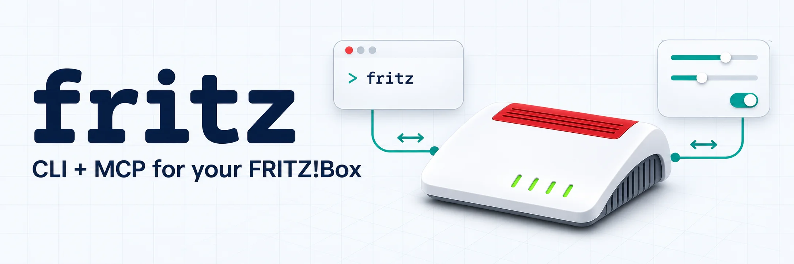

# fritz

<picture>
  <source media="(prefers-color-scheme: dark)" srcset="https://raw.githubusercontent.com/udondan/fritz/main/docs/banner-dark.webp">
  <source media="(prefers-color-scheme: light)" srcset="https://raw.githubusercontent.com/udondan/fritz/main/docs/banner-light.webp">
  
</picture>

[](https://github.com/udondan/fritz/releases/latest)
[](https://hub.docker.com/r/udondan/fritz)
[](https://github.com/udondan/fritz/actions/workflows/test.yml)
[](https://codecov.io/gh/udondan/fritz)
[](https://qlty.sh/gh/udondan/projects/fritz)
[](https://github.com/udondan/fritz/blob/main/LICENSE)

A command line tool and MCP server that lets you and your AI agents read the
status and settings of a FRITZ!Box router.

> [!NOTE]
> **Unofficial.** This project is not affiliated with, endorsed by or supported
> by FRITZ! GmbH (formerly AVM). FRITZ! and FRITZ!Box are trademarks of
> FRITZ! GmbH.

> [!WARNING]
> **Early release.** Reading works over TR-064 and the Smart Home REST API.
> Released builds cannot change anything; changing settings needs the cargo
> feature `write` and several explicit opt-ins (see [SECURITY.md](https://github.com/udondan/fritz/blob/main/SECURITY.md)).

## Installation

```sh
brew install udondan/software/fritz   # macOS and Linux
cargo install fritz                   # from source
docker pull udondan/fritz             # see Docker below
```

The [releases](https://github.com/udondan/fritz/releases) also have binaries
for Linux (x86_64, aarch64, static), macOS and Windows. `SHA256SUMS.txt` lists
their checksums and is signed with the GPG key `F111A9BDD62F384A`:

```sh
gpg --verify SHA256SUMS.txt.asc SHA256SUMS.txt
sha256sum --check --ignore-missing SHA256SUMS.txt
```

The Docker image is signed with cosign by the release workflow:

```sh
cosign verify udondan/fritz \
  --certificate-identity-regexp '^https://github.com/udondan/fritz/' \
  --certificate-oidc-issuer https://token.actions.githubusercontent.com
```

## Crates

| Crate | crates.io | docs.rs | Purpose |
| --- | --- | --- | --- |
| [`tr064`](https://github.com/udondan/fritz/tree/main/crates/tr064) | [![tr064 on crates.io][tr064-crate-badge]][tr064-crate] | [![tr064 on docs.rs][tr064-docs-badge]][tr064-docs] | Vendor-neutral TR-064 (UPnP/SOAP) client |
| [`fritz-core`](https://github.com/udondan/fritz/tree/main/crates/fritz-core) | [![fritz-core on crates.io][fritz-core-crate-badge]][fritz-core-crate] | [![fritz-core on docs.rs][fritz-core-docs-badge]][fritz-core-docs] | FRITZ!-specific logic: login, Smart Home API, policy, redaction |
| [`fritz-sim`](https://github.com/udondan/fritz/tree/main/crates/fritz-sim) | [![fritz-sim on crates.io][fritz-sim-crate-badge]][fritz-sim-crate] | [![fritz-sim on docs.rs][fritz-sim-docs-badge]][fritz-sim-docs] | Fake FRITZ!Box for tests, built from recorded fixtures |
| [`fritz`](https://github.com/udondan/fritz/tree/main/crates/fritz) | [![fritz on crates.io][fritz-crate-badge]][fritz-crate] | – | The binary: CLI and `fritz mcp` |

[tr064-crate-badge]: https://img.shields.io/crates/v/tr064?label=
[tr064-crate]: https://crates.io/crates/tr064
[tr064-docs-badge]: https://img.shields.io/docsrs/tr064?label=
[tr064-docs]: https://docs.rs/tr064
[fritz-core-crate-badge]: https://img.shields.io/crates/v/fritz-core?label=
[fritz-core-crate]: https://crates.io/crates/fritz-core
[fritz-core-docs-badge]: https://img.shields.io/docsrs/fritz-core?label=
[fritz-core-docs]: https://docs.rs/fritz-core
[fritz-sim-crate-badge]: https://img.shields.io/crates/v/fritz-sim?label=
[fritz-sim-crate]: https://crates.io/crates/fritz-sim
[fritz-sim-docs-badge]: https://img.shields.io/docsrs/fritz-sim?label=
[fritz-sim-docs]: https://docs.rs/fritz-sim
[fritz-crate-badge]: https://img.shields.io/crates/v/fritz?label=
[fritz-crate]: https://crates.io/crates/fritz

## MCP server

`fritz mcp` serves the state of the device to an MCP client on stdin and
stdout. It only reads. Store the password first with `fritz auth login`, then
add the server to the client, for example to Claude Code:

```sh
claude mcp add fritz -- fritz --host 192.168.178.1 --user agent mcp
```

| Tool                    | Returns                                                     |
| ----------------------- | ----------------------------------------------------------- |
| `fritz_overview`        | Model, firmware, uptime, update, connection, rights         |
| `fritz_internet`        | Internet connection, addresses, DNS, rates, DSL line        |
| `fritz_wlan`            | Wireless networks                                           |
| `fritz_hosts`           | Known hosts, filtered by `active` and `search`, paginated   |
| `fritz_mesh`            | Mesh nodes and links                                        |
| `fritz_smarthome`       | Smart Home devices (FRITZ!OS 8.20 and later)                |
| `fritz_ports`           | Port forwardings and whether UPnP is on                     |
| `fritz_telephony`       | Numbers, accounts, deflections, answering machines, DECT    |
| `fritz_capabilities`    | Features of the device, rights of the user, two-factor      |
| `fritz_settings`        | Settings like DNS, IPv6, MTU, DHCP and time, secrets hidden |
| `fritz_list_services`   | TR-064 services, or the actions of one with their class     |
| `fritz_describe_action` | The arguments of an action and their types                  |
| `fritz_call_action`     | Calls an action that only reads, with secrets hidden        |

Calls, contacts and the event log are personal, so `fritz mcp` only serves
them with `--personal` (or `FRITZ_MCP_PERSONAL=true`). Without it,
`fritz_call_action` refuses the actions behind them and hides the event log
that `DeviceInfo:GetInfo` returns as well. The option adds three tools:

| Tool              | Returns                                                     |
| ----------------- | ----------------------------------------------------------- |
| `fritz_calls`     | Latest calls, filtered by `kind`                            |
| `fritz_phonebook` | Contacts of all phonebooks, filtered by `search`, paginated |
| `fritz_log`       | Event log, filtered by `search`                             |

Errors from the device come back as JSON with a `status` (`denied`,
`confirmation_required`, `blocked` or `busy`) and, where it helps,
`retry_after` in seconds.

Agents that use the CLI instead can load the skill in
[skills/fritz/SKILL.md](https://github.com/udondan/fritz/blob/main/skills/fritz/SKILL.md).

### Docker

The image runs `fritz`; without a command it starts the MCP server. A
container has no keychain, so the device and the password come from the
environment. Get the fingerprint once with `fritz tls fingerprint`.

```sh
docker run --rm -i \
  -e FRITZ_HOST=192.168.178.1 -e FRITZ_USERNAME=agent \
  -e FRITZ_PASSWORD -e FRITZ_TLS_FINGERPRINT \
  udondan/fritz
```

`mise run docker-build` builds the image from source. For the Docker MCP
Toolkit, `mise run docker` builds it and adds
[docker-mcp.yml](https://github.com/udondan/fritz/blob/main/docker-mcp.yml) to the profile `fritz`. Set the secrets
`fritz.host`, `fritz.username`, `fritz.password` and `fritz.fingerprint`
with `docker mcp secret set`. The container must be able to reach the box.

## Changes

Release builds only read. Builds with the feature `write` add `fritz change`,
which plans a change, shows the current and the new values, and applies it
with the token of the plan:

```sh
cargo build -p fritz --features write
fritz change identity        # add it to [write] allow in the configuration
FRITZ_ALLOW_WRITE=1 fritz change plan WLANConfiguration3 SetEnable NewEnable=0
FRITZ_ALLOW_WRITE=1 fritz change apply WLANConfiguration3 SetEnable NewEnable=0 --token <token>
```

A plan shows only the inputs of the action, but a device may change other
settings along with them. `apply` reads the service before and after the
change and lists the other values that changed under `also changed`.

With `FRITZ_ALLOW_WRITE=1`, `fritz mcp` of such a build also offers
`fritz_plan_change` and `fritz_apply_change`, which work the same way.

Changes are only made to devices on the allow list, and never to those on the
deny list. See [SECURITY.md](https://github.com/udondan/fritz/blob/main/SECURITY.md#changes) for all checks.

## Security

`fritz` is read-only by default. See [SECURITY.md](https://github.com/udondan/fritz/blob/main/SECURITY.md) for the security
model and how to report a vulnerability.

## Contributing

See [CONTRIBUTING.md](https://github.com/udondan/fritz/blob/main/CONTRIBUTING.md).

## License

[Apache-2.0](https://github.com/udondan/fritz/blob/main/LICENSE)

## Disclaimer

This is an unofficial, independent open source project. It is not affiliated
with FRITZ! GmbH (formerly AVM). FRITZ! and FRITZ!Box are trademarks of
FRITZ! GmbH. The names are only used to describe compatibility. Use this tool
at your own risk. Changing router settings can cut off your network access.
